  

  
  
  

  

<h3 align="center"><code>✦ projects ✦</code></h3>

  
  

<h3 align="center"><code>✦ stack ✦</code></h3>

  

<h3 align="center"><code>✦ stats ✦</code></h3>

  
  

  

  

  

